# 모니터링 설정을 API로 한 단계씩

새 PC(노트북)에서 저장소를 받는 것부터 시작해, Elasticsearch·Kibana·Grafana 설정을 **HTTP API를 직접 호출해서** 넣는 순서입니다.
`monitoring/setup.sh`는 아래 2~10단계를 한 번에 실행하는 스크립트(정답지)입니다. 따라 하다 막히면 같은 부분을 열어 비교합니다.

```mermaid
flowchart LR
  app["앱 (bootRun, dev)"] -->|".logs/app.log"| fb[Filebeat]
  fb -->|filebeat_writer| es[(Elasticsearch)]
  es --> kb[Kibana]
  app -->|/actuator/prometheus| prom[Prometheus]
  prom --> gf[Grafana]
  gf -.->|"패널 링크 (같은 시간대)"| kb
```



Grafana는 **숫자(메트릭)**만, Kibana는 **로그**만 봅니다. Grafana에서 이상을 발견하면 패널의 링크로 같은 시간대의 Kibana "최근 에러"로 넘어가 원인을 찾습니다. 화면을 읽는 법은 맨 아래 [화면 보는 법](#화면-보는-법)에 있습니다.

## 0. 준비물

| 항목 | 기준 |
|---|---|
| Docker Desktop | 실행 중. **메모리 6GB 이상** 할당 권장 (ES 힙 1GB + Kibana 약 1GB) |
| Git Bash | 아래 명령은 모두 Git Bash 기준. PowerShell에서는 따옴표·`$변수` 규칙이 달라 그대로 안 된다 |
| JDK 21 | 앱(`./gradlew bootRun`) 실행용 |
| 빈 포트 | 5432(Postgres), 9200(ES), 5601(Kibana), 9090(Prometheus), 3001(Grafana), 8080(앱) |
| 디스크 | 이미지 첫 다운로드 약 3GB |

## 1. 받기와 띄우기

### 1-1. 저장소 받기

```bash
git clone https://github.com/sb14-4team/sb14-deokhugam-4team.git
```
```bash
cd sb14-deokhugam-4team
```
```bash
git switch chore/monitoring_김승호
```

### 1-2. `.env` 만들기

```bash
cp .env.example .env
```

- `.env`는 Git에 올라가지 않는 로컬 전용 파일입니다. 모니터링 비밀번호(`ELASTIC_PASSWORD` 등)는 예시 값 그대로 써도 됩니다(포트를 127.0.0.1에만 열기 때문).
- `KAKAO_REST_API_KEY`, `OCR_SPACE_API_KEY`, `AWS_*`는 해당 기능(ISBN 조회, OCR, 썸네일)에만 쓰입니다. 모니터링 실습에는 예시 값 그대로 두어도 앱이 뜹니다.
- 포트가 이미 쓰이고 있으면 `.env`에서 바꿉니다: Postgres는 `POSTGRES_PORT`, Grafana는 `GRAFANA_PORT`.
  (PC에 Grafana를 따로 설치했다면 3000을 쓰고 있을 수 있어서 기본값을 3001로 두었습니다.)

### 1-3. 컨테이너 띄우기

```bash
docker compose --profile monitoring up -d
```
```bash
docker compose --profile monitoring ps
```

- `--profile monitoring`을 빼면 Postgres만 뜹니다(평소 개발용).
- `--wait`는 붙이지 않습니다. Kibana는 2단계를 하기 전까지 준비 완료가 되지 않아서 `--wait`가 끝나지 않습니다.
- `elasticsearch`가 `healthy`가 될 때까지 1~2분 걸립니다. Kibana·Filebeat는 그 뒤에 시작합니다.

### 1-4. 비밀번호를 셸 변수로 읽기

이후 명령은 이 창에서 실행합니다. 새 창을 열면 다시 실행합니다.
```bash
set -a; . ./.env; set +a
```

---

## 2단계. ES에 인증해서 호출하고, Kibana를 ES에 연결

**인증 없이 호출** → `missing authentication credentials` 오류가 정상입니다(보안을 켜 둠).
```bash
curl -s localhost:9200
```

**인증해서 호출** → `version.number`가 `9.5.3`이면 성공. `-u 사용자:비밀번호`가 Basic 인증입니다.
```bash
curl -s -u elastic:$ELASTIC_PASSWORD localhost:9200
```

**클러스터 상태** → `green` 모든 샤드 정상 / `yellow` 복제본을 둘 곳 없음(노드 1대에서 흔함) / `red` 원본 일부 없음.
```bash
curl -s -u elastic:$ELASTIC_PASSWORD "localhost:9200/_cluster/health?pretty"
```

**Kibana가 아직 안 뜬 이유 보기** → `"level":"unavailable"`(아무것도 안 나오면 Kibana가 아직 시작 중이니 30초 뒤 다시).
```bash
curl -s localhost:5601/api/status
```
로그에 `unable to authenticate user [kibana_system]`이 보입니다.
```bash
docker compose --profile monitoring logs kibana | grep "unable to authenticate" | tail -2
```

Kibana는 내장 사용자 **`kibana_system`**으로 ES에 붙는데, 이 사용자의 비밀번호를 아직 아무도 정하지 않았습니다.
(`elastic` 슈퍼유저로 Kibana를 붙이는 것은 ES 8부터 막혀 있습니다.)

**첫 쓰기 API: `kibana_system` 비밀번호 정하기** → 응답 `{}`가 성공입니다.
```bash
curl -s -u elastic:$ELASTIC_PASSWORD -X POST localhost:9200/_security/user/kibana_system/_password -H "Content-Type: application/json" -d "{\"password\":\"$KIBANA_SYSTEM_PASSWORD\"}"
```

- 본문을 큰따옴표로 감싼 이유: `$KIBANA_SYSTEM_PASSWORD`가 실제 값으로 바뀌어야 합니다. 작은따옴표 안에서는 변수가 바뀌지 않습니다.
- 이 값은 compose가 Kibana에 넘긴 `ELASTICSEARCH_PASSWORD`와 같습니다. Kibana가 다음 재시도에서 접속에 성공합니다.

**30초~1분 뒤 확인** → `200`이면 http://localhost:5601 에서 `elastic` / `.env`의 `ELASTIC_PASSWORD`로 로그인해 봅니다.
```bash
curl -s -o /dev/null -w "%{http_code}\n" -u elastic:$ELASTIC_PASSWORD localhost:5601/api/status
```

> 기억할 것: ES 호출의 기본 모양은 `curl -u 사용자:비밀번호 -X 메서드 주소/경로 -H "Content-Type: application/json" -d '본문'`.
> 경로가 `_`로 시작하면 ES 기능(API), 아니면 인덱스 이름입니다.

---

## 3단계. 로그 보관 정책 (ILM)

로그 인덱스를 하루마다(또는 1GB마다) 새 인덱스로 넘기고, 7일 지나면 지웁니다. 로컬 디스크가 차지 않게 합니다.

```bash
curl -s -u elastic:$ELASTIC_PASSWORD -X PUT localhost:9200/_ilm/policy/deokhugam-logs -H "Content-Type: application/json" --data-binary @- <<'JSON'
{
  "policy": {
    "phases": {
      "hot": { "actions": { "rollover": { "max_age": "1d", "max_primary_shard_size": "1gb" } } },
      "delete": { "min_age": "7d", "actions": { "delete": {} } }
    }
  }
}
JSON
```

- `--data-binary @-`와 `<<'JSON' ... JSON`(heredoc): 여러 줄 본문을 표준 입력으로 보냅니다. 따옴표 이스케이프가 필요 없고, **한글이 깨지지 않습니다**(Windows curl은 명령줄 인자로 받은 한글을 깨뜨림).
- `'JSON'`처럼 따옴표를 붙이면 본문 안의 `$`를 변수로 바꾸지 않습니다.
- PUT은 "이 이름으로 이 내용이 되게 하라"는 뜻이라 여러 번 보내도 결과가 같습니다.

확인:
```bash
curl -s -u elastic:$ELASTIC_PASSWORD "localhost:9200/_ilm/policy/deokhugam-logs?pretty"
```

---

## 4단계. 인제스트 파이프라인 (로그 한 줄 → 필드)

앱 로그 한 줄(`logback-spring.xml`의 dev 패턴, 로거 뒤에 MDC 요청 정보가 붙음):
```
2026-10-29 22:53:42.788 [http-nio-8080-exec-3] INFO  c.s.d.c.e.GlobalExceptionHandler     [requestId=9be6... | clientIp=0:0:0:0:0:0:0:1 | method=GET | uri=/api/books/x] -  잘못된 요청: ...
2026-10-29 22:53:23.988 [main] INFO  c.s.deokhugam.DeokhugamApplication     [requestId=none | clientIp=none | method=none | uri=none] -  Started DeokhugamApplication ...
```
이것을 `@timestamp`, `process.thread.name`, `log.level`, `log.logger`, `http.request.id`, `client.ip`, `http.request.method`, `url.path`, `message`로 나눕니다. ES에 저장되기 직전에 실행됩니다.

**먼저 저장하지 않고 시험(`_simulate`)** — 파이프라인 정의와 시험 문서를 함께 보냅니다.
```bash
curl -s -u elastic:$ELASTIC_PASSWORD -X POST "localhost:9200/_ingest/pipeline/_simulate?pretty" -H "Content-Type: application/json" --data-binary @- <<'JSON'
{
  "pipeline": {
    "processors": [
      { "dissect": { "field": "message",
          "pattern": "%{log_time} %{+log_time} [%{process.thread.name}] %{log.level->} %{log.logger} [requestId=%{http.request.id} | clientIp=%{client.ip} | method=%{http.request.method} | uri=%{url.path}] - %{log_message}" } }
    ]
  },
  "docs": [
    { "_source": { "message": "2026-10-29 22:53:42.788 [http-nio-8080-exec-3] INFO  c.s.d.c.e.GlobalExceptionHandler     [requestId=9be614108a2c41da85a14b61aa750ee7 | clientIp=0:0:0:0:0:0:0:1 | method=GET | uri=/api/books/x] -  잘못된 요청: bookId" } }
  ]
}
JSON
```

결과에서 세 가지가 아직 이상합니다.
- `log_time`이 `2026-10-2922:53:42.788`처럼 **날짜와 시각이 붙어** 있습니다. `%{+log_time}`은 앞 조각에 "이어 붙이기"인데 기본 구분자가 빈 문자열이기 때문입니다. 이대로 날짜 처리기에 넣으면 파싱이 실패하고 ES가 로그를 거부합니다(실제로 겪은 문제).
- `log.logger` 끝에 공백이 남습니다(패턴의 줄바꿈이 공백으로 찍힘).
- `log_message` 앞에 공백이 있습니다(`%kvp`가 비어서).

**고친 버전을 저장**:
```bash
curl -s -u elastic:$ELASTIC_PASSWORD -X PUT localhost:9200/_ingest/pipeline/deokhugam-logs -H "Content-Type: application/json" --data-binary @- <<'JSON'
{
  "description": "logback 줄(날짜 [스레드] 레벨 로거 [요청 정보] - 메시지)을 필드로 나눈다",
  "processors": [
    { "dissect": {
        "description": "dev 패턴: 로거 뒤에 MDC 요청 정보가 붙는다",
        "field": "message",
        "pattern": "%{log_time} %{+log_time} [%{process.thread.name}] %{log.level->} %{log.logger} [requestId=%{http.request.id} | clientIp=%{client.ip} | method=%{http.request.method} | uri=%{url.path}] - %{log_message}",
        "append_separator": " ",
        "ignore_failure": true } },
    { "dissect": {
        "description": "요청 정보가 없는 패턴 (dev 외 프로필)",
        "if": "ctx.log_time == null",
        "field": "message",
        "pattern": "%{log_time} %{+log_time} [%{process.thread.name}] %{log.level->} %{log.logger} - %{log_message}",
        "append_separator": " ",
        "ignore_failure": true } },
    { "trim": { "field": "log.logger", "ignore_missing": true } },
    { "remove": {
        "description": "요청 밖에서 찍힌 로그는 요청 정보가 none이라 지운다",
        "if": "ctx.http?.request?.id == 'none'",
        "field": ["http", "client", "url"],
        "ignore_missing": true } },
    { "date": {
        "if": "ctx.log_time != null",
        "field": "log_time",
        "formats": ["yyyy-MM-dd HH:mm:ss.SSS"],
        "timezone": "Asia/Seoul",
        "on_failure": [{ "append": { "field": "tags", "value": "log_time_parse_failure" } }] } },
    { "set": { "if": "ctx.log_message != null", "field": "message", "copy_from": "log_message" } },
    { "trim": { "field": "message", "ignore_missing": true } },
    { "remove": { "field": ["log_time", "log_message"], "ignore_missing": true } }
  ]
}
JSON
```

| 처리기 | 하는 일 |
|---|---|
| `dissect` (1) | dev 패턴으로 자릅니다. `append_separator: " "`로 날짜·시각 사이에 공백을 넣습니다. `%{log.level->}`의 `->`는 `%-5level`이 넣은 여러 칸 공백을 건너뜁니다. 맞지 않는 줄은 `ignore_failure`로 그냥 넘깁니다 |
| `dissect` (2) | (1)이 실패했을 때만(`if: ctx.log_time == null`) 요청 정보가 없는 패턴으로 다시 시도합니다 |
| `trim` | `log.logger` 끝 공백 제거 |
| `remove` | 요청 밖 로그(앱 시작 등)는 요청 정보가 전부 `none`이라 지웁니다. `ctx.http?.request?.id`의 `?.`는 필드가 없어도 오류 없이 넘어가는 문법(painless) |
| `date` | `log_time` → `@timestamp`. 시간대를 안 주면 UTC로 읽어 9시간 어긋납니다. 실패해도 버리지 않고 `tags`에 표시만 합니다 |
| `set` + `trim` | 줄 전체였던 `message`를 본문만으로 바꾸고 앞 공백을 지웁니다 |
| `remove` | 임시 필드를 지웁니다 |

**저장한 파이프라인으로 시험** — 요청 로그, 요청 밖 로그, 스택 트레이스, 요청 정보 없는 형식, 형식이 다른 줄:
```bash
curl -s -u elastic:$ELASTIC_PASSWORD -X POST "localhost:9200/_ingest/pipeline/deokhugam-logs/_simulate?pretty" -H "Content-Type: application/json" --data-binary @- <<'JSON'
{
  "docs": [
    { "_source": { "message": "2026-10-29 22:53:42.788 [http-nio-8080-exec-3] INFO  c.s.d.c.e.GlobalExceptionHandler     [requestId=9be614108a2c41da85a14b61aa750ee7 | clientIp=0:0:0:0:0:0:0:1 | method=GET | uri=/api/books/x] -  잘못된 요청: bookId" } },
    { "_source": { "message": "2026-10-29 22:53:23.988 [main] INFO  c.s.deokhugam.DeokhugamApplication     [requestId=none | clientIp=none | method=none | uri=none] -  Started DeokhugamApplication" } },
    { "_source": { "message": "2026-10-29 19:20:00.001 [main] ERROR c.s.d.BookService     [requestId=abc | clientIp=127.0.0.1 | method=DELETE | uri=/api/books/1] -  삭제 실패\njava.lang.IllegalStateException: boom\n\tat c.s.d.BookService.delete(BookService.java:10)" } },
    { "_source": { "message": "2026-10-29 19:18:14.872 [main] INFO  c.s.d.BookService - 요청 정보 없는 형식" } },
    { "_source": { "message": "형식이 다른 줄" } }
  ]
}
JSON
```
성공 기준: `@timestamp`가 `...+09:00`, 첫 번째·세 번째에 `http.request.id`·`client.ip`·`url.path`가 있고, 두 번째에는 없고, 다섯 번째는 `message`만 남습니다.

> 로그 파일은 UTF-8로 씁니다(`logback-spring.xml` 파일 appender의 `<charset>UTF-8</charset>`). 한국어 Windows에서는 Gradle이 JVM 기본 인코딩을 CP949로 넘겨서, 이 설정이 없으면 Filebeat(UTF-8로 읽음)를 거친 한글이 Kibana에서 깨집니다.


---

## 5단계. 데이터 스트림 템플릿

"`deokhugam-logs`라는 이름으로 로그가 들어오면 이렇게 저장하라"는 규칙입니다. 3단계 정책과 4단계 파이프라인을 여기서 연결합니다.

```bash
curl -s -u elastic:$ELASTIC_PASSWORD -X PUT localhost:9200/_index_template/deokhugam-logs -H "Content-Type: application/json" --data-binary @- <<'JSON'
{
  "index_patterns": ["deokhugam-logs*"],
  "data_stream": {},
  "priority": 500,
  "template": {
    "settings": {
      "number_of_replicas": 0,
      "index.lifecycle.name": "deokhugam-logs",
      "index.default_pipeline": "deokhugam-logs"
    },
    "mappings": {
      "properties": {
        "@timestamp": { "type": "date" },
        "message": { "type": "text" },
        "log": { "properties": { "level": { "type": "keyword" }, "logger": { "type": "keyword" } } },
        "process": { "properties": { "thread": { "properties": { "name": { "type": "keyword" } } } } },
        "http": { "properties": { "request": { "properties": { "id": { "type": "keyword" }, "method": { "type": "keyword" } } } } },
        "client": { "properties": { "ip": { "type": "keyword" } } },
        "url": { "properties": { "path": { "type": "keyword" } } }
      }
    }
  }
}
JSON
```

| 설정 | 이유 |
|---|---|
| `data_stream: {}` | 첫 로그가 들어올 때 ES가 데이터 스트림을 자동으로 만듭니다. 추가만 하는 로그에 맞는 구조입니다 |
| `index.default_pipeline` | 누가 보내든 4단계 파이프라인을 거칩니다. 그래서 Filebeat 설정에는 파이프라인을 적지 않았습니다 |
| `index.lifecycle.name` | 3단계 보관 정책을 붙입니다 |
| `number_of_replicas: 0` | 노드가 1대라 복제본을 둘 곳이 없습니다. 0이 아니면 `yellow`로 남습니다 |
| `keyword` / `text` | 레벨·로거·requestId·IP·URI는 집계와 정확히 일치 검색용(keyword), 본문은 단어 검색용(text). requestId로 검색하면 요청 하나의 로그만 모아 볼 수 있습니다 |

- 템플릿은 **새로 만들어지는 인덱스에만** 적용됩니다. 나중에 바꾸면 `POST /deokhugam-logs/_rollover`로 새 인덱스를 만들어 반영합니다.

---

## 6단계. 역할·사용자 만들기 → 로그 들어오기 시작

Filebeat와 Grafana에 슈퍼유저를 주지 않고, 필요한 권한만 가진 사용자를 따로 만듭니다.

**역할 2개**:
```bash
curl -s -u elastic:$ELASTIC_PASSWORD -X PUT localhost:9200/_security/role/deokhugam_logs_writer -H "Content-Type: application/json" -d '{"cluster":["monitor"],"indices":[{"names":["deokhugam-logs*"],"privileges":["create_doc","auto_configure","view_index_metadata"]}]}'
```
```bash
curl -s -u elastic:$ELASTIC_PASSWORD -X PUT localhost:9200/_security/role/deokhugam_logs_reader -H "Content-Type: application/json" -d '{"cluster":["monitor"],"indices":[{"names":["deokhugam-logs*"],"privileges":["read","view_index_metadata"]}]}'
```

| 권한 | 뜻 |
|---|---|
| `monitor` (클러스터) | ES 버전·상태 조회. Filebeat·Grafana가 접속할 때 확인합니다 |
| `create_doc` | 문서 추가만 (수정·삭제 불가) |
| `auto_configure` | 첫 로그가 들어올 때 데이터 스트림을 자동 생성 |
| `read` | 검색 |
| `view_index_metadata` | 필드 목록(매핑) 조회 |

**사용자 2명** (비밀번호는 `.env`의 값):
```bash
curl -s -u elastic:$ELASTIC_PASSWORD -X PUT localhost:9200/_security/user/filebeat_writer -H "Content-Type: application/json" -d "{\"password\":\"$FILEBEAT_ES_PASSWORD\",\"roles\":[\"deokhugam_logs_writer\"]}"
```
```bash
curl -s -u elastic:$ELASTIC_PASSWORD -X PUT localhost:9200/_security/user/grafana_reader -H "Content-Type: application/json" -d "{\"password\":\"$GRAFANA_ES_PASSWORD\",\"roles\":[\"deokhugam_logs_reader\"]}"
```

**앱 띄우기** — Git Bash 창을 하나 더 열어 저장소 폴더에서:
```bash
./gradlew bootRun
```
`Started DeokhugamApplication`이 보이면, 원래 창으로 돌아와 요청을 몇 번 보냅니다.
```bash
for i in 1 2 3; do curl -s -o /dev/null localhost:8080/v3/api-docs; done
```

Filebeat는 지금까지 `filebeat_writer` 인증에 실패하며 재시도하고 있었습니다. 사용자가 생겼으니 10~20초 안에 로그가 들어옵니다.
```bash
curl -s -u elastic:$ELASTIC_PASSWORD localhost:9200/deokhugam-logs/_count
```
```bash
curl -s -u elastic:$ELASTIC_PASSWORD "localhost:9200/deokhugam-logs/_search?size=1&sort=@timestamp:desc&pretty"
```
```bash
curl -s -u elastic:$ELASTIC_PASSWORD "localhost:9200/_data_stream/deokhugam-logs?pretty"
```
마지막 응답에서 `status: GREEN`, `ilm_policy: deokhugam-logs`, `template: deokhugam-logs`를 확인합니다.

**권한이 정말 막히는지** → Filebeat 계정으로 검색하면 `403`, Grafana 계정이면 `200`:
```bash
curl -s -o /dev/null -w "%{http_code}\n" -u filebeat_writer:$FILEBEAT_ES_PASSWORD localhost:9200/deokhugam-logs/_search
```
```bash
curl -s -o /dev/null -w "%{http_code}\n" -u grafana_reader:$GRAFANA_ES_PASSWORD localhost:9200/deokhugam-logs/_search
```

---

## 7단계. Kibana 데이터 뷰

데이터 뷰 = "어느 인덱스를 어느 시간 필드로 볼지". Discover·시각화가 모두 이것을 기준으로 합니다.
Kibana API는 **쓰기 요청마다 `kbn-xsrf: true` 헤더**가 필요합니다(없으면 400).

```bash
curl -s -u elastic:$ELASTIC_PASSWORD -X POST localhost:5601/api/data_views/data_view -H "Content-Type: application/json" -H "kbn-xsrf: true" --data-binary @- <<'JSON'
{
  "data_view": {
    "id": "deokhugam-logs",
    "name": "덕후감 로그",
    "title": "deokhugam-logs*",
    "timeFieldName": "@timestamp"
  },
  "override": true
}
JSON
```
```bash
curl -s -u elastic:$ELASTIC_PASSWORD -X POST localhost:5601/api/data_views/default -H "Content-Type: application/json" -H "kbn-xsrf: true" -d '{"data_view_id":"deokhugam-logs","force":true}'
```

- `id`를 고정하고 `override: true`라서 다시 보내도 하나만 생깁니다. id를 안 주면 보낼 때마다 새로 생깁니다.
- 확인: http://localhost:5601/app/discover → "덕후감 로그"가 열리고, 왼쪽 필드 목록에서 `log.level`을 눌러 레벨별 비율을 봅니다.
- Prometheus가 15초마다 `/actuator/prometheus`를 불러서 그 요청 로그가 대부분입니다. 검색창에 `NOT url.path:/actuator*`를 넣으면 실제 API 요청 로그만 남습니다.
- 요청 하나의 로그만 모아 보기: 로그 한 줄을 펼쳐 `http.request.id` 값 옆 돋보기(+)를 누르면 같은 requestId 로그만 걸러집니다.

---

## 8단계. Grafana 서비스 계정과 토큰

Grafana API는 **서비스 계정 토큰**(`Authorization: Bearer ...`)으로 부릅니다. Grafana Cloud에는 admin 비밀번호가 없고 토큰만 쓰기 때문에, 로컬에서도 같은 방식으로 익힙니다. 토큰을 만드는 처음 한 번만 admin 계정을 씁니다.

**서비스 계정 만들기** → 응답의 `"id"` 숫자를 봅니다.
```bash
curl -s -u admin:$GRAFANA_ADMIN_PASSWORD -X POST localhost:$GRAFANA_PORT/api/serviceaccounts -H "Content-Type: application/json" -d '{"name":"deokhugam-setup","role":"Admin"}'
```
역할이 Admin인 이유: 데이터 소스를 만들려면 Admin이 필요합니다(Editor면 403).

**위 응답의 id를 넣고 토큰 만들기** (예: id가 2이면 `SA_ID=2`):
```bash
SA_ID=2
```
```bash
curl -s -u admin:$GRAFANA_ADMIN_PASSWORD -X POST localhost:$GRAFANA_PORT/api/serviceaccounts/$SA_ID/tokens -H "Content-Type: application/json" -d '{"name":"practice","secondsToLive":3600}'
```

**응답의 `"key"` 값(`glsa_`로 시작)을 변수에 넣기**:
```bash
GRAFANA_TOKEN=glsa_여기에_붙여넣기
```

- `secondsToLive: 3600`이라 1시간 뒤 만료됩니다. 만료되면 토큰 만들기만 이름을 바꿔(`practice2`) 다시 합니다. 같은 이름이면 400.
- 토큰이 맞는지 확인 → 조직 정보가 나오면 성공:
```bash
curl -s -H "Authorization: Bearer $GRAFANA_TOKEN" localhost:$GRAFANA_PORT/api/org
```

---

## 9단계. Grafana 데이터 소스

**Prometheus** (앱 메트릭):
```bash
curl -s -X POST localhost:$GRAFANA_PORT/api/datasources -H "Authorization: Bearer $GRAFANA_TOKEN" -H "Content-Type: application/json" -d '{"uid":"deokhugam-prometheus","name":"Prometheus","type":"prometheus","access":"proxy","url":"http://prometheus:9090","isDefault":true}'
```

| 항목 | 이유 |
|---|---|
| 주소가 `localhost`가 아니라 `prometheus` | `access: proxy`라서 브라우저가 아니라 Grafana 컨테이너가 요청합니다. 컨테이너끼리는 compose 서비스 이름으로 찾습니다 |
| `uid` 고정 | 아래 확인 명령과 스크립트가 이 uid로 부릅니다. 대시보드는 uid 대신 `datasource` 변수로 고르므로 운영 Grafana에 올려도 끊기지 않습니다 |
| Elasticsearch 데이터 소스는 없음 | 로그는 Kibana에서만 봅니다. 같은 로그 화면을 두 곳에서 관리하지 않기 위해서입니다 |

**연결 확인** → `"status":"OK"`:
```bash
curl -s -H "Authorization: Bearer $GRAFANA_TOKEN" localhost:$GRAFANA_PORT/api/datasources/uid/deokhugam-prometheus/health
```

- 같은 POST를 다시 보내면 이름 중복으로 409가 납니다. 바꿀 때는 `PUT /api/datasources/uid/<uid>`에 같은 본문을 보냅니다(`setup.sh`는 있으면 PUT, 없으면 POST).

---

## 10단계. 대시보드 올리기와 뽑기

**올리기** — `grafana-dashboard.json`을 `{"dashboard": ..., "overwrite": true}`로 감싸서 보냅니다:
```bash
{ printf '{"dashboard": '; cat monitoring/grafana-dashboard.json; printf ', "overwrite": true}'; } | curl -s -X POST localhost:$GRAFANA_PORT/api/dashboards/db -H "Authorization: Bearer $GRAFANA_TOKEN" -H "Content-Type: application/json" --data-binary @-
```
→ `"status":"success"`, `"url":"/d/deokhugam-app/..."`. 브라우저에서 http://localhost:3001/d/deokhugam-app (admin 로그인).

| 행 | 기본 | 패널 |
|---|---|---|
| 한눈에 (항상 서비스 전체) | 펼침 | 실행 중 태스크 · 분당 요청 · 5xx 비율 · p95 응답 시간 · 힙 사용률 · DB 커넥션 대기 |
| API (태스크·API 변수 적용) | 펼침 | 분당 요청 · 5xx 비율 · p95 응답 시간, 각각 상위 5개 API |
| DB · JVM (태스크 변수 적용) | 펼침 | DB 커넥션 풀 · 힙 사용률 · CPU 사용률 · 스레드 수 |
| 외부 API | 접힘 | 카카오·OCR p95 · 실패율 |

- 모든 쿼리는 `job="spring"`(운영 Prometheus와 같은 job 이름)을 기준으로 합니다. 쿼리와 기준값(점선·색)은 각 패널의 ⓘ 설명과 JSON에 있습니다.
- 한눈에 Stat은 상단 변수와 상관없이 항상 전체를 보여 줍니다. 트래픽·에러·지연은 합계, 힙·DB 대기는 가장 높은 태스크 값입니다.
- 범례는 URI 대신 기능 이름(예: `리뷰 작성 (POST /api/reviews)`)으로 보입니다. API를 새로 만들면 JSON의 `displayName` 덮어쓰기에 한 줄 추가합니다.
- 5xx·p95 패널의 링크를 누르면 같은 시간대의 Kibana "최근 에러"가 열립니다. Kibana 주소는 숨긴 변수 `kibana_url`(기본 `http://localhost:5601`)이라 운영에 올릴 때 이 값만 바꿉니다.
- 화면 위 파란 세로선은 앱이 새로 뜬 시점(배포·재시작)입니다.
- 대시보드 JSON에 `uid`(`deokhugam-app`)는 넣고 `id`는 넣지 않습니다. id는 Grafana마다 다른 내부 번호라 다른 곳에 올릴 때 꼬입니다.

> p95 패널과 스레드 패널의 "바쁜 요청 스레드"는 앱 설정이 켜져야 값이 나옵니다(운영 설정은 인프라 담당 작업). 로컬에서는 앱을 이렇게 띄우면 바로 볼 수 있습니다:
> ```bash
> MANAGEMENT_METRICS_DISTRIBUTION_PERCENTILESHISTOGRAM_HTTP_SERVER_REQUESTS=true SERVER_TOMCAT_MBEANREGISTRY_ENABLED=true ./gradlew bootRun
> ```
> 외부 API 행은 `KakaoClientConfig`·`OcrSpaceClientConfig`가 스프링의 `RestClient.Builder`를 쓰도록 바뀐 뒤에 값이 나옵니다.

**패널 쿼리를 화면 없이 시험** — Grafana가 패널을 그릴 때 쓰는 API입니다:
```bash
curl -s -X POST localhost:$GRAFANA_PORT/api/ds/query -H "Authorization: Bearer $GRAFANA_TOKEN" -H "Content-Type: application/json" -d '{"from":"now-1h","to":"now","queries":[{"refId":"A","datasource":{"uid":"deokhugam-prometheus"},"expr":"sum by (uri) (http_server_requests_seconds_count)"}]}'
```

**화면에서 고친 대시보드를 파일로 뽑기** — 패널을 화면에서 고치고 저장한 뒤:
```bash
curl -s -H "Authorization: Bearer $GRAFANA_TOKEN" localhost:$GRAFANA_PORT/api/dashboards/uid/deokhugam-app > dashboard-export.json
```
응답의 `"dashboard"` 안쪽만 `monitoring/grafana-dashboard.json`에 옮기고 `id`·`version` 줄을 지우면, 다음부터 10단계 올리기로 같은 대시보드가 만들어집니다.

---

## 11단계. Kibana 로그 화면 올리기와 뽑기

Kibana 화면(저장된 검색 4개, 막대 그래프, 대시보드)은 `monitoring/kibana-objects.ndjson` 한 파일에 들어 있습니다. 한 줄이 객체 하나입니다.

| id | 종류 | 내용 |
|---|---|---|
| `deokhugam-logs` | 대시보드 "덕후감 로그" | 최근 24시간, 기본 검색 `NOT url.path : /actuator*`, 레벨·로거 드롭다운, 아래 두 패널 |
| `deokhugam-error-loggers` | Lens 막대 | ERROR·WARN이 많이 나는 로거 Top 10 (ERROR 빨강, WARN 노랑) |
| `deokhugam-recent-errors` | 저장된 검색 "최근 에러" | `log.level : (ERROR or WARN)`, 최신순. Grafana 링크가 이 id로 엽니다. 원인 예외가 있는 서버 실패(예: OCR 500)는 `GlobalExceptionHandler`가 WARN으로 남기므로 WARN도 함께 봅니다 |
| `deokhugam-request-trace` | 저장된 검색 "요청 추적" | `http.request.id : "<값>"`, 오래된 순 |
| `deokhugam-external-api-failures` | 저장된 검색 "외부 API 실패" | 카카오·OCR·S3 어댑터 로그와 에러 코드 `BOOK_OCR_UNAVAILABLE`·`BOOK_THUMBNAIL_UPLOAD_FAILED` |
| `deokhugam-app-lifecycle` | 저장된 검색 "앱 시작·종료" | `Started DeokhugamApplication`, `Commencing graceful shutdown` |

**올리기** — 파일 업로드(`-F`)라 `Content-Type`을 직접 적지 않습니다. 7단계 데이터 뷰가 먼저 있어야 합니다:
```bash
curl -s -u elastic:$ELASTIC_PASSWORD -H "kbn-xsrf: true" -X POST "localhost:5601/api/saved_objects/_import?overwrite=true" -F file=@monitoring/kibana-objects.ndjson
```
→ `"success":true,"successCount":6`. 브라우저에서 http://localhost:5601/app/dashboards#/view/deokhugam-logs

**화면에서 고친 뒤 파일로 뽑기** — 대시보드·저장된 검색을 화면에서 고치고 저장한 뒤:
```bash
curl -s -u elastic:$ELASTIC_PASSWORD -H "kbn-xsrf: true" -H "Content-Type: application/json" -X POST localhost:5601/api/saved_objects/_export --data-binary @- <<'JSON' | jq -c 'select(.type != "index-pattern")' > monitoring/kibana-objects.ndjson
{"objects":[{"type":"dashboard","id":"deokhugam-logs"},{"type":"search","id":"deokhugam-request-trace"},{"type":"search","id":"deokhugam-external-api-failures"},{"type":"search","id":"deokhugam-app-lifecycle"}],"includeReferencesDeep":true,"excludeExportDetails":true}
JSON
```
- `includeReferencesDeep`가 대시보드 안의 막대 그래프와 "최근 에러"까지 함께 뽑습니다.
- 데이터 뷰(`index-pattern`)는 7단계가 만들므로 파일에서 뺍니다.
- 새 저장된 검색을 만들면 화면 기본값인 무작위 id가 붙습니다. 다른 곳에서 링크로 가리킬 거라면 위처럼 API로 고정 id를 정해 만듭니다.
- Kibana 9.5의 저장된 검색은 실제 검색어·열을 `attributes.tabs[]` 안에 둡니다. 바깥의 `kibanaSavedObjectMeta`만 고쳐서는 화면에 반영되지 않으니, 검색어는 화면(Discover)에서 고치고 저장한 뒤 다시 뽑습니다.
- 올린 뒤에도 Discover에 예전 검색어가 보이면, 그 브라우저 탭이 이전 상태를 기억하고 있는 것입니다. 새 탭에서 열면 저장된 내용이 보입니다.

---

## 화면 보는 법

| 질문 | 어디서 |
|---|---|
| 지금 서비스가 정상인가? | Grafana 맨 위 "한눈에" 6개. 초록이면 정상, 노랑은 주의, 빨강은 문제 |
| 어느 API가 문제인가? | Grafana "API" 행 (상위 5개). 다른 API는 상단 `API` 변수로 골라 봅니다 |
| 서버 자원이 부족한가? | Grafana "DB · JVM" 행 |
| 정확히 무슨 에러인가? | Kibana "최근 에러" (스택 트레이스 포함) |
| 그 요청은 무엇을 했나? | Kibana "요청 추적" |

장애 때 흐름:
1. Grafana "5xx 비율"이 빨갛게 바뀝니다.
2. "5xx 비율 (API별)"에서 어느 API인지 봅니다.
3. 패널의 Kibana 링크를 누르면 같은 시간대의 "최근 에러"가 열립니다.
4. 에러 한 줄을 펼쳐 `http.request.id` 옆 돋보기(+)를 누르면 그 요청의 로그만 시간 순으로 남습니다.

> 알아 둘 한계: Prometheus는 새로 생긴 시계열(예: 앱이 뜬 뒤 처음 나는 `POST /api/books/isbn/ocr` 500)의 **첫 증가분을 세지 못합니다**. 처음 한두 건의 에러는 Grafana에 안 보이고 Kibana에만 남을 수 있습니다. 같은 에러가 이어지면 그때부터 그래프에 잡힙니다.

---

## 한 번에 하기, 처음으로 되돌리기, 끄기

- **한 번에**: `bash monitoring/setup.sh` — 2~11단계를 순서대로 실행합니다. 몇 번을 실행해도 결과가 같습니다.
- **ES·Kibana·Grafana를 빈 상태로 되돌려 다시 연습** (Postgres 데이터는 남김):
```bash
docker compose --profile monitoring rm -sf elasticsearch kibana filebeat grafana
```
```bash
docker volume ls -q | grep -E "_(es|grafana|filebeat)-data$" | xargs docker volume rm
```
```bash
docker compose --profile monitoring up -d
```
- **끄기**(데이터 유지): `docker compose --profile monitoring down`. `-v`를 붙이면 **Postgres 데이터까지** 지워집니다.

## 자주 막히는 곳

| 증상 | 원인 → 해결 |
|---|---|
| Grafana 포트 `bind: ... forbidden` | 그 포트를 다른 프로그램(PC에 설치한 Grafana 등)이 씀 → `.env`의 `GRAFANA_PORT` 변경 |
| 한글이 `�`로 저장됨 | 한글이 든 본문을 `-d "..."` 인자로 보냄 → heredoc(`--data-binary @- <<'JSON'`)으로 |
| `_count`가 계속 `index_not_found` | 앱이 안 떠 있거나(로그 파일 없음), 6단계 사용자 미생성, 또는 파이프라인 오류로 ES가 거부 → `docker compose --profile monitoring logs filebeat --tail 20`에서 `Cannot index event` 확인 |
| 파이프라인을 고쳤는데 지난 로그가 다시 안 들어옴 | Filebeat가 읽은 위치를 기억함 → 위 "되돌리기"에서 `filebeat` 볼륨만 지우고 다시 띄움 |
| `$ELASTIC_PASSWORD`가 비어 401 | 새 창에서 1-4를 안 함 → `set -a; . ./.env; set +a` |
| Git Bash에서 `docker exec ... /경로`가 `C:/Program Files/Git/...`로 바뀜 | Git Bash 경로 변환 → 명령 앞에 `MSYS_NO_PATHCONV=1` |
| Prometheus 대상 `deokhugam`이 down | 앱이 8080에 안 떠 있음. http://localhost:9090/targets 에서 오류 확인 |
